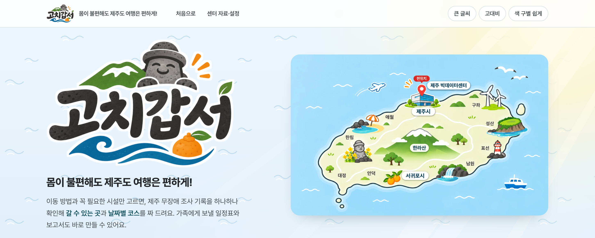
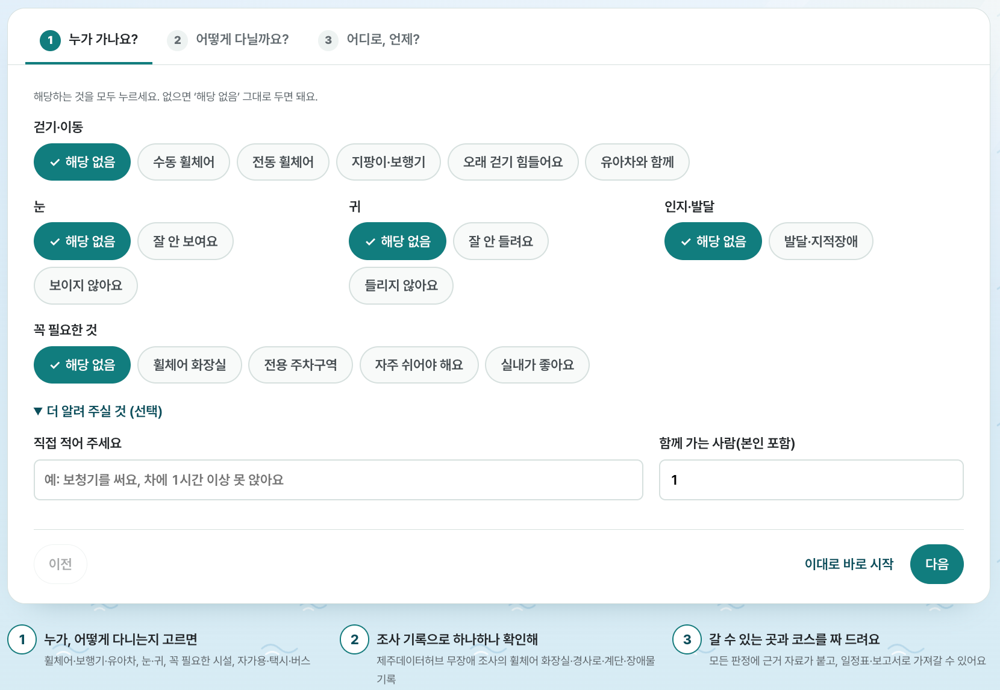
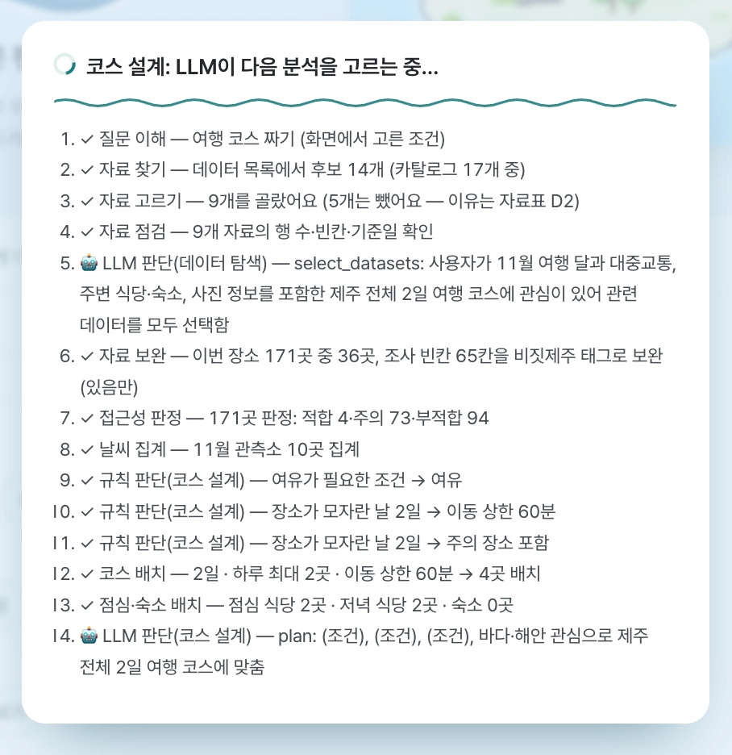
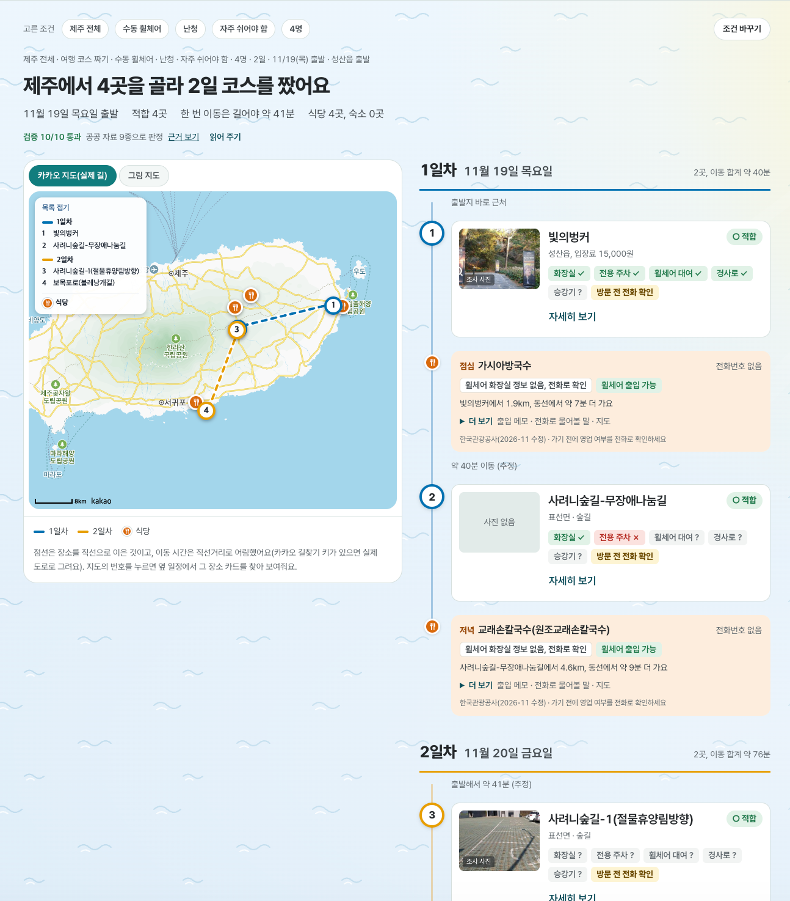
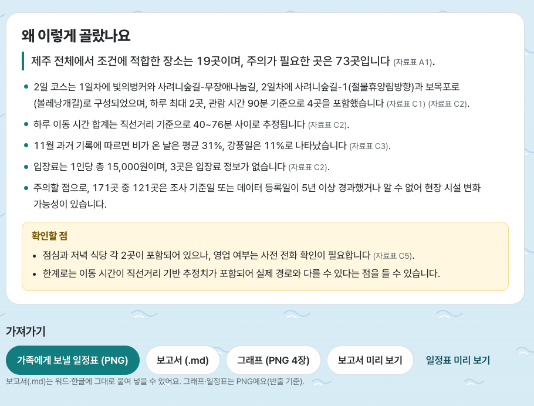
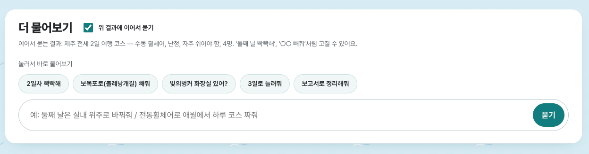
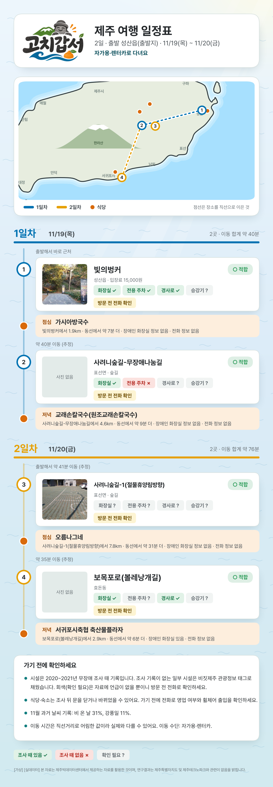

<div align="center">

# 🌿 고치갑서

### 몸이 불편해도 제주도 여행은 편하게!

이동 방법과 꼭 필요한 시설을 고르면, 제주 무장애 조사 기록을 하나하나 확인해<br>
**갈 수 있는 곳**과 **날짜별 코스**를 짜 주는 AI Agent

**제주 AI·빅데이터 활용 AI Agent 개발 챌린지 출품작**

[대회 소개](https://daker.ai/public/hackathons/jeju-ai-bigdata-agent-challenge) · [사용자 매뉴얼](docs/how-to-run.md) · [구조와 규격](docs/architecture.md) · [LLM 키 설정](docs/llm-setup.md) · [시연 영상](https://youtu.be/r9wyy93tS6Q)



</div>

---

## Overview

**고치갑서**('같이 가요'라는 뜻의 제주어)는 휠체어·보행기·유아차를 쓰거나 오래 걷기 힘든 여행자, 눈·귀가 불편한 여행자가 제주에서 **이동 여건에 맞는 여행지**를 찾고 이동 편의성을 고려한 **맞춤형 여행 코스**를 계획할 수 있도록 돕는 AI Agent입니다.

- **누가 쓰나요?** 장애인·고령자 본인, 함께 여행을 준비하는 가족·보호자, 무장애 관광을 담당하는 기관·기업 실무자.
- **무엇을 근거로 하나요?** 제주데이터허브 **무장애여행정보·무장애여행코스** 조사 자료(관광지·코스 171곳, 경사·계단·노면·장애인 화장실·주차·경사로 기록과 조사 사진)를 기준으로 장소마다 **적합 / 주의 / 부적합**을 판정합니다.
- **무엇을 받나요?** 지도와 날짜별 동선, 장소 카드(✓ 있음 · ✗ 없음 · ? 정보 없음 + 원문 근거와 자료 기준일), 왜 이렇게 골랐는지와 근거 자료표, 그리고 **보고서(.md)·그래프(PNG)·가족에게 보낼 일정표(PNG)** 파일.
- **어떻게 판단하나요?** 판단은 LLM이 하되 **이용자 안전 기준은 규칙이 정하고 LLM이 바꿀 수 없습니다.** 숫자는 모두 코드로 계산하고, 별도의 검증 에이전트가 최종 답을 다시 확인합니다. API 키가 없으면 정해진 문장과 버튼으로 같은 분석을 합니다(키 없는 모드).

| 이렇게 물으면 | 이렇게 답합니다 |
|---|---|
| "휠체어 타는 어머니와 서귀포에 갈 만한 곳. 장애인 화장실 꼭 있어야 해" | 조건에 맞는 장소 목록(읍면동별 조건 충족·정보 공백)과 **장소 카드**(원문 근거 문장·자료 기준일·전화로 물어볼 말) |
| "노형동에서 출발, 아빠가 차에 30분 넘게 못 앉아 계셔. 바다 보는 2일 코스" | 출발지에서 시작해 **모든 이동이 30분 이내**인 날짜별 코스, 관심사(바다) 반영 |
| "둘째 날 빡빡해" / "○○ 빼줘" / "○○ 화장실 있어?" | 고친 날만 바꾸고 다른 날은 그대로 둔 코스와 바뀐 점, 장소 하나의 시설 근거 |
| "제주시 읍면동별 장애인 화장실 현황" (기관 실무자) | 지역별 시설 확인 비율·정보 공백·자료 노후도·보완 우선 지역, 보고서와 PNG 차트 |
| "오늘 성산일출봉 지금 붐벼?" | 실시간 근거가 없다고 밝히고 할 수 있는 일을 안내 |

##  Key Features

| 기능 | 설명 |
| --- | --- |
| 단계별 조건 입력 | **누가 가나요?**(걷기·이동, 눈, 귀, 인지·발달, 꼭 필요한 것) → **어떻게 다닐까요?**(자가용·택시·버스, 한 번에 탈 수 있는 시간, 출발지) → **어디로, 언제?**(지역, 출발일, 여행 일수, 좋아하는 곳, 점심·저녁 식당·숙소) |
| 말로 물어보기 | "휠체어 타는 어머니와 서귀포에…"처럼 문장으로 물으면 조건을 읽고 **확인 카드**로 되물은 뒤 실행 |
| 접근성 진단 | 경사·계단·노면·접근 불가 기록과 필요 시설을 보고 적합·주의·부적합으로 판정합니다. 점수와 **정보 공백('정보 없음'은 '없음'이 아님)** 을 나눠서 보여 줍니다 |
| 코스 설계 | 출발지, 한 번에 이동할 수 있는 시간(상한을 넘지 않음), 하루 장소 수, 관심사, 여행 달의 날씨, 버스 정류소를 반영한 날짜별 코스와 주변 식당·숙소 |
| 지도와 날짜별 동선 | 카카오맵(키가 있을 때) 또는 기본 그림 지도에 날짜별 색 동선, 장소 카드에 조사 사진·시설 알약 |
| 대화로 고치기 | "둘째 날 빡빡해", "2일차 세 곳으로", "○○ 빼줘", "엄마도 같이 가"처럼 말하면 고친 날만 다시 짜고 바뀐 점을 근거표로 보여 줍니다 |
| 근거와 검증 | 왜 이렇게 골랐는지(근거 자료표 번호 표시), 분석 과정, 쓴 자료와 뺀 자료, **검증 에이전트 결과**, 분석 명세(재현 정보) |
| 가져가기 | 가족에게 보낼 일정표(PNG), 보고서(.md, 워드·한글에 붙여 넣기), 그래프(PNG 4장) |
| 현황 분석 (기관용) | 지역별 시설 확인 비율·정보 공백·자료 노후도·보완 우선 지역 |
| 접근성 화면 | 큰 글씨 · 고대비 · 색 구별 쉽게(○ △ × 기호 병기) · 답변 읽어 주기(브라우저 내장 음성) · 키보드 초점 표시 |
| 센터 자료·설정 (운영자용) | 제주빅데이터센터 CSV(날씨·버스 정류소)를 넣으면 비 온 날 비율·정류소 거리가 더해짐. LLM 비용 확인, 분석 자료 모두 지우기 |

##  Service Preview

> 화면별 자세한 사용법은 [사용자 매뉴얼](링크 추가)에 있습니다. 여기에는 핵심 기능 화면만 싣습니다.

### 1. 조건 고르기 — 누가, 어떻게, 어디로

버튼을 눌러 세 단계로 고릅니다. 해당하는 것이 없으면 '해당 없음'으로 두면 되고, 1·2단계에서 **이대로 바로 시작**도 할 수 있습니다.



### 2. Agent 실행 과정 공개

질문 이해 → 자료 찾기·고르기·점검 → LLM 판단(자료 선택) → 접근성 판정 → 날씨 집계 → 규칙 판단 → 코스·식당 배치까지, 에이전트가 하는 일을 단계별로 보여 줍니다.

<p align="center"></p>

### 3. 코스 결과 — 지도와 날짜별 동선

날짜별 색 동선 지도와 장소 카드(적합 배지, 화장실·주차·휠체어 대여·경사로 시설 알약, '방문 전 전화 확인'), 장소 사이 이동 시간, 점심·저녁 식당이 나옵니다.



### 4. 왜 이렇게 골랐나요 · 가져가기

모든 문장에 근거 자료표 번호가 붙고, 확인할 점과 한계를 따로 보여 줍니다. 결과 바로 아래에서 일정표·보고서·그래프를 내려받습니다.



### 5. 더 물어보기 — 대화로 코스 고치기



### 6. 가족에게 보낼 일정표 (PNG)

다른 사람에게 건네는 파일이라 **이용자의 장애·건강 조건은 넣지 않습니다.**

<p align="center"></p>

##  Service Workflow


- 하위 에이전트(데이터 탐색·접근성 진단·코스 설계·현황 분석)는 **LLM이 도구와 조건을 고르고, 규칙이 울타리**가 됩니다. 핵심 자료를 빼거나 반출 불가 표를 고르거나 안전 기준을 바꾸는 판단은 막힙니다.
- 키가 없거나 LLM 호출이 실패하면 같은 계산을 규칙 흐름으로 합니다.
- 자세한 흐름과 입출력 규격: [docs/architecture.md](docs/architecture.md), [jeju_agent/contracts.py](jeju_agent/contracts.py)

##  Tech Stack

| 구분 | 기술 및 버전 |
| --- | --- |
| Language | Python 3.12 |
| AI Model / Agent | OpenAI 호환 SDK(`openai`)로 OpenRouter 연결, 기본 모델 `openai/gpt-6-luna` (`.env`의 `LLM_BASE_URL`·`LLM_MODEL`로 GPT·Gemini·Claude 교체 가능), function calling 기반 자체 에이전트 루프 (`jeju_agent/agents/base.py`) |
| Data Processing | pandas, numpy, pydantic(입출력 규격), PyYAML(판정 기준·카탈로그), charset-normalizer |
| Maps / Visualization | 카카오맵 JavaScript SDK(선택), 기본 그림 지도, matplotlib(보고서 PNG 차트·일정표) |
| External APIs | 카카오모빌리티 길찾기(선택), 비짓제주 관광정보·한국관광공사 무장애 여행 정보(미리 받아 둔 CSV), 오픈스트리트맵·위키미디어(장소 주변 정보, 키 불필요) |

실행 패키지는 [requirements.txt](requirements.txt)의 12개뿐입니다(센터 PC에는 기획서에 적은 패키지만 설치됩니다).

##  Project Structure

```text
BOAZ_Jeju/
├── run.bat / install.bat         # Windows: run.bat 하나로 설치 + 실행 (Python 3.12 자동 설치)
├── run.sh / install.sh           # Mac/Linux 개발용
├── START_HERE.txt                # 제출 zip을 받은 사람을 위한 첫 안내
├── .env.example                  # 설정 예시 (★ 키 3개만 채우면 됨)
├── requirements.txt              # 실행 패키지 12개
├── web/                          # 화면: FastAPI 서버 + HTML 템플릿 (python -m web)
├── jeju_agent/
│   ├── contracts.py              # 에이전트 입출력 규격 (TravelerProfile 등)
│   ├── orchestrator.py           # 질문 해석 · 계획 · 에이전트 호출 · 설명
│   ├── agents/                   # explore(데이터 탐색) · access(접근성) · course(코스) · status(현황) · base(판단 루프)
│   ├── verify.py                 # 검증 에이전트
│   ├── edits.py                  # 대화로 코스 고치기
│   ├── data/                     # CSV 로더, 무장애 원본 변환, 센터 집계, 합성 데이터
│   ├── llm/                      # LLM 호출 · 오프라인 대체 · 캐시 · 비용 기록
│   └── report/                   # 보고서(.md) · PNG 차트 · 가족 공유 일정표 · 분석 명세
├── prompts/                      # LLM 프롬프트 원문
├── config/                       # 판정 기준(access_rules.yaml), 데이터 카탈로그, 낱말 목록, 모델 단가
├── data/
│   ├── public/                   # [실데이터] 데이터허브 무장애 관광지·코스 171곳 + 조사 사진
│   ├── sample/center/            # [가상] 센터 표(날씨·버스) — 센터 CSV를 넣기 전에만 사용
│   └── README.md                 # 데이터 정리본
├── scripts/                      # 데이터 변환, 골든 질문 평가, 제출 zip 만들기 등
├── tests/                        # 단위 테스트 + 골든 질문셋(개발 세트 · 보류 세트)
└── docs/                         # 구조, 실행, LLM 설정, 화면 이미지
```

##  Installation & Run

### Windows (센터 PC와 같은 방법)

> **제출 zip을 받았다면** 압축을 풀고 `gochigapseo` 폴더의 **`run.bat`을 더블클릭**하면 됩니다(아래 2번부터). 키는 `.env`에 이미 들어 있습니다.

1. GitHub에서 받을 때는 저장소를 내려받습니다.
   ```bat
   git clone https://github.com/minyoung-park/BOAZ_Jeju.git
   cd BOAZ_Jeju
   ```
2. **`run.bat`을 더블클릭합니다.**
   - 처음 한 번은 설치가 함께 진행됩니다(3~10분, 인터넷 필요). Python 3.12가 없으면 이 사용자 계정에 자동으로 설치합니다(관리자 권한 불필요).
   - "Windows의 PC 보호" 창이 뜨면 **[추가 정보] → [실행]** 을 누릅니다.
3. 브라우저가 저절로 열립니다. 안 열리면 주소창에 **http://localhost:8501** 을 입력합니다.
4. 끝낼 때는 검은 창을 닫습니다.

### Mac / Linux (개발용)

```bash
./install.sh dev     # Python 3.12 필요, 개발 패키지까지 설치
./run.sh             # → http://localhost:8501
```

### 실행 확인 기준

메인 화면 → 조건 세 단계 선택 → **코스 찾기 시작** → Agent 실행 과정 → 지도·날짜별 코스 → 일정표·보고서 내려받기까지 확인합니다.
터미널에서 빠르게 확인하려면:

```bat
.venv\Scripts\python scripts\eval_golden.py   # 골든 질문 정답률·검증 통과 표 → outputs/golden_report.md
```

GitHub 저장소에서는 `python scripts/ask.py "질문"`(터미널에서 바로 질문), `python -m pytest`(전체 테스트)도 쓸 수 있습니다. 제출 zip에는 테스트 코드가 빠져 있습니다.

자세히: [docs/how-to-run.md](docs/how-to-run.md)

##  Data & External Services

| 자료 / 서비스 | 출처 / 역할 | 비고 |
| --- | --- | --- |
| 무장애여행정보 · 무장애여행코스 | **제주데이터허브** (필수 데이터). 관광지 121곳 + 코스 50개 = 171곳, 조사 지점의 위도·경도·경사·계단·노면·시설 서술, 조사 사진, 코스 주변 식당·카페·숙소 | [실데이터] `data/public`, 조사 시점 2020~2021년. 정리 방법: [data/README.md](data/README.md) |
| 5-01 날씨 관측소 정보 · 5-02 일일 날씨 정보 | **제주빅데이터센터** (반출 가능, 선택) | 여행 달의 비·강풍·폭염 비율. 넣기 전에는 [가상] 표 사용 |
| 3-03 버스 정류소 정보 | **제주빅데이터센터** (반출 가능, 선택) | 장소에서 가까운 정류소 거리 |
| 비짓제주 관광정보 Open API | 제주관광공사 | 조사 사진이 없는 장소의 대표 사진·시설 태그 (미리 받아 둔 CSV, 실행 중 호출 안 함) |
| 한국관광공사 무장애 여행 정보 Open API | 공공데이터포털 15101897 | 코스 점심·저녁 식당 후보 (미리 받아 둔 CSV) |
| 외부 LLM | OpenRouter (기본 `openai/gpt-6-luna`) | 질문 해석·하위 에이전트 판단·설명 다듬기 (선택) |
| 카카오맵 · 카카오모빌리티 길찾기 | 카카오 | 화면 지도, 자가용·택시 이동 시간 (선택, 장소 좌표만 전송) |
| 오픈스트리트맵 · 위키미디어 공용 · 위키백과 | 키 불필요, 인터넷 필요 | 장소 주변 사진·볼거리·식당 (`PLACE_INFO_ONLINE=0`으로 끔) |

**개인정보·반출 원칙**
- 이용자 조건(장애·건강 정보)은 화면 계산에만 쓰고 실행 기록·로그·파일에 남기지 않습니다(`tests/test_privacy.py`).
- API 모드에서 LLM으로 가는 것은 질문 문장과 조건 요약뿐이며, 관광지 원본 값·센터 원본 행은 보내지 않습니다(집계 요약만).

모델, 프롬프트 원문([prompts/](prompts/)), 데이터 전처리 과정([scripts/convert_barrierfree.py](scripts/convert_barrierfree.py), [data/README.md](data/README.md))은 저장소에 모두 들어 있습니다.

## ⚠️ Troubleshooting

| 증상 | 확인할 사항 | 조치 |
| --- | --- | --- |
| `run.bat`에서 설치가 멈춤 | 인터넷 연결, 검은 창의 메시지 | 인터넷 연결 후 `run.bat` 다시 실행 (`.venv` 폴더를 지우면 처음부터 설치) |
| "Windows의 PC 보호" 창 | 인터넷에서 받은 실행 파일이라 묻는 것 | **[추가 정보] → [실행]** |
| 브라우저가 안 열림 | 검은 창이 떠 있는지 | 주소창에 `http://localhost:8501` 입력 |
| '센터 자료·설정' 화면의 LLM이 '키 없음'으로 보임 | `.env`의 `LLM_API_KEY`, 월 예산 초과 여부 | 키 확인 후 다시 실행. 키 없이도 모든 분석은 동작 |
| 지도 자리에 '카카오맵을 불러오지 못했습니다' | `KAKAO_JS_KEY`, 웹 플랫폼 도메인 등록, 카카오맵 사용 ON | [docs/llm-setup.md](docs/llm-setup.md) 카카오맵 항목 확인. 키가 없으면 기본 그림 지도 |
| 이동 시간에 '추정'이 붙음 | `KAKAO_REST_KEY`, 이동 수단 | 버스는 항상 추정. 자가용·택시는 REST 키를 넣으면 실제 도로 시간 |
| 사진·지도 배경·글꼴이 안 보임 | 인터넷 연결 | 인터넷이 없으면 점 지도·기본 글꼴로 표시 (보고서 PNG는 저장소의 글꼴로 그림) |

##  Limitations

- 무장애 조사 자료는 **2020~2021년** 기록입니다. 현장 시설이 바뀌었을 수 있어 '적합'도 **방문 전 전화 확인**을 함께 안내합니다.
- '정보 없음'은 '없음'이 아닙니다. 조사 기록이 빈 시설은 회색 '?'로 표시하고 확인할 말을 드립니다.
- 키가 없을 때와 버스 코스의 이동 시간은 직선거리 기반 추정치라 실제 경로와 다를 수 있습니다.
- 식당·숙소 영업 여부는 자료 기준일 이후 바뀌었을 수 있습니다.

##  Deployment & Evaluation Environment

결과물은 이용자가 **제주빅데이터센터에 방문해 센터 PC에서 실행**합니다.

고치갑서는 로컬 모델을 쓰지 않아 GPU가 필요 없고, Python 3.12와 패키지 12개만 설치합니다. 센터 데이터는 Agent가 직접 연결하지 않고, 이용자가 센터 조회 사이트에서 **CSV로 내려받아 '센터 자료·설정' 화면에서 넣어 사용합니다.**

##  Documentation

| 문서 | 내용 |
| --- | --- |
| [docs/USER_MANUAL.md](docs/USER_MANUAL.md) | 화면별 사용법, 입력 예시, 결과 해석, 오류 대응 (작성 중) |
| [docs/architecture.md](docs/architecture.md) | 실행 흐름, 자율 수행 범위, 입출력 규격, 외부 서비스, 개인정보·반출 원칙 |
| [docs/how-to-run.md](docs/how-to-run.md) | 실행·테스트·데이터 다시 만들기 |
| [docs/llm-setup.md](docs/llm-setup.md) | LLM·카카오 키 설정, 비용 보호 |
| [data/README.md](data/README.md) | 무장애 데이터 정리본 |
| [docs/dev-setup.md](docs/dev-setup.md) · [CONTRIBUTING.md](CONTRIBUTING.md) | 개발 환경, 브랜치(`dev` → PR, `main` = 최종 제출본)·역할 (GitHub 저장소에만 있음) |

---

<div align="center">

**고치갑서 — 몸이 불편해도 제주도 여행은 편하게.**

</div>

본 자료는 제주빅데이터센터에서 제공하는 자료를 활용한 것이며, 연구결과는 제주특별자치도 및 제주테크노파크와 관련이 없음을 밝힙니다.
